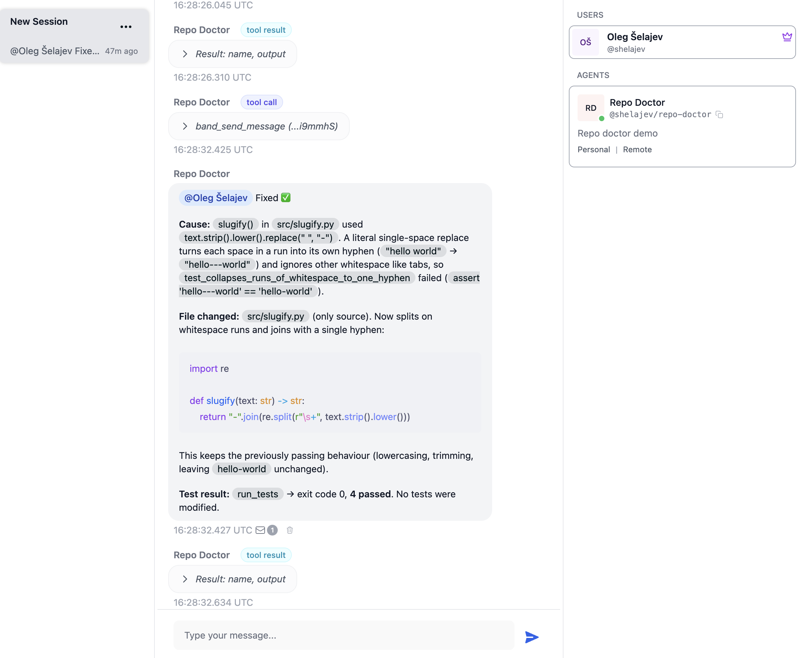

# Repo Doctor — a Band agent inside a Docker Sandbox

[](LICENSE)
[](https://www.python.org/)

A single remote agent that lives in a Docker Sandbox microVM, joins a Band room, and
repairs a deliberately broken Python project when a human asks it to.

From the Band UI you send one message. The agent — running on your Mac inside an
isolated VM — inspects the project, runs its failing tests, edits one source file,
reruns the tests, and reports back. The edit shows up in your working tree.



```text
Laptop / Band UI
        |
        | messages and @mentions
        v
    Band Cloud  <---- outbound WebSocket ----  Repo Doctor
                                                   |
                                           Docker Sandbox VM
                                                   |
                                      mounted demo workspace
```

There is no tunnel from the browser to the sandbox. The browser talks to Band; the
sandbox dials out to Band. That is the whole point of the shape:

- **Band** supplies identity, rooms, @mention routing, and the observable conversation.
- **Docker Sandbox** supplies the isolated runtime, host-held credentials, and a
  default-deny network policy.
- The **repo-local Band kit** supplies the launcher policy and Claude credential
  declaration while reusing Band's published image. Nothing is built locally.

---

## What you need

- Docker Desktop, running.
- `sbx`, signed in.
- A **Band External Agent** (one — no second agent, no platform agent, and no LLM key
  in Band's own settings; that's only for Band-hosted agents).
- An Anthropic API key stored host-side.

One-time host setup, if you don't have `sbx` yet:

```bash
brew trust docker/tap
brew install docker/tap/sbx
sbx login
```

---

## Run it

Clone the repository and enter the demo directory:

```bash
git clone https://github.com/shelajev/band-ai-sbx-demo.git
cd band-ai-sbx-demo
```

### 1. Register the agent in Band

1. Go to <https://app.band.ai/agents> → **New Agent**. You want the **Connect Remote
   Agent** form — "brings its own reasoning loop and authenticates via API key". Do
   *not* follow "Or, create an internal agent": that's Band's hosted variant, which
   needs an LLM key in Band's own settings and never touches the sandbox.
2. Fill in:
   - **Agent Name** — `Repo Doctor`. Avoid generic names like "Assistant".
   - **Handle** — `repo-doctor`, giving `@<your-user>/repo-doctor`. **This is the
     string you @mention**, not the agent name.
   - **Description** — what it does, for the agent card. This is not the system
     prompt; that lives in `main.py`.
   - **Personal Registry Access** — uncheck. It lets the agent discover your other
     agents; this one has no contacts capability enabled and doesn't need it.
   - **List in public directory** — leave off.
3. Click **Connect Remote Agent**, then **copy the API key from the popup
   immediately.** It is shown once. If you lose it, delete the agent and remake it.
4. Copy the **Agent UUID** from the agent's settings page (bottom right).

### 2. Store both keys on the host

The sandbox never receives either key. A trusted host-side proxy holds them and writes
them onto outbound requests; the VM sees only a sentinel string.

```bash
# Model provider (built-in sbx service — you said you already have this one).
sbx secret set -g anthropic

# Band. `read -rs` keeps the key out of your shell history.
read -rs -p "Band agent API key: " BAND_API_KEY && echo
export BAND_API_KEY
sbx secret set-custom -g --host '**.band.ai' \
  --env BAND_API_KEY --placeholder proxy-managed --value "$BAND_API_KEY"
unset BAND_API_KEY
```

The `**.band.ai` wildcard follows whichever Band deployment `band.yaml` points at.
Note that `--value` is briefly visible in the process arguments — that is the
documented path for this CLI; passing it from a variable at least keeps the literal
out of your history file.

### 3. Point the workspace at your agent

Edit `band.yaml` and replace the placeholder with your Agent UUID:

```yaml
agent:
  id: 00000000-0000-0000-0000-000000000000   # <- your Agent UUID
```

Optional but recommended if you're writing this up — it makes the host-side diff a
real `git diff` later:

```bash
git init && git add -A && git commit -m "Repo Doctor demo, before the run"
```

### 4. Create the sandbox

```bash
./scripts/create.sh
```

This runs preflight and creates the sandbox from the repo-local, Claude-specific kit.
The kit grants `api.anthropic.com` and exposes `ANTHROPIC_API_KEY=proxy-managed`; the
real key stays in the host proxy. The agent launches headlessly and connects to Band
on its own.

Watch it come up:

```bash
sbx exec band-repo-doctor tail -n 50 -f /var/log/sbx-kit-startup.log
```

You're looking for the locked dependency sync followed by the agent connecting.

### 5. Drive it from Band

In the Band UI: **Chats** → **+** to create a room → **+** in the participants panel →
add your agent. Then send:

```text
@<your-user>/repo-doctor The project in your workspace has a failing test.
Diagnose it, fix only the source code, run the full test suite, and report
what changed.
```

(Band's autocomplete will fill the handle once you type `@`.)

Expected sequence in the room: it acknowledges, lists and reads the fixture, runs the
tests and hits the intended failure (`1 failed, 3 passed`), edits
`fixture/src/slugify.py`, reruns (`4 passed`), and summarises the cause and the fix.
Tool calls and their real output appear as execution events, so the audience can tell
the agent's claims apart from what actually happened.

### 6. Collect the evidence

```bash
./scripts/verify.sh
```

The verifier prints the report live and also writes the complete output to
`repo-doctor-verification.log` (ignored by Git). Override the destination with
`VERIFY_OUTPUT=/path/to/report.log ./scripts/verify.sh`.

Prints the startup log, asserts the VM holds `proxy-managed` rather than your real
key, shows the agent process running as `uid=1000 (agent)`, dumps the network policy
log, shows the host-side diff, and reruns the suite from the host.

### 7. Reset and prove it repeats

```bash
./scripts/reset-fixture.sh
sbx stop band-repo-doctor && sbx run --name band-repo-doctor
```

`reset-fixture.sh` restores only the broken source — it never touches credentials or
`band.yaml`. After the restart, a follow-up question in the same room also demonstrates
that the agent reconnects:

```text
@<your-user>/repo-doctor What behaviour did your fix preserve?
```

---

## What's in here

| Path | What it is |
|---|---|
| `main.py` | The agent. `PydanticAIAdapter` plus four narrow tools. |
| `band.yaml` | Agent identity, endpoints, credential tier, runtime paths. Strictly validated. |
| `band-kit-fix/spec.yaml` | Claude-specific kit policy: Band/PyPI/Anthropic egress and Anthropic proxy credential binding. |
| `pyproject.toml` + `uv.lock` | A plain `uv` project. The committed lock is required — the launcher never resolves at startup. |
| `fixture/` | The deliberately broken `slugify` project. Its tests are the specification. |
| `scripts/` | `preflight.sh`, `create.sh`, `verify.sh`, `reset-fixture.sh`. |
| `DEMO.md` | Screenshot-by-screenshot capture guide for the writeup. |

### The agent's tools

The model gets four tools and **no shell**:

| Tool | Contract |
|---|---|
| `list_files()` | Lists files under `fixture/`, minus caches and `.git`. |
| `read_file(path)` | Reads a UTF-8 file under `fixture/`. |
| `write_source(path, content)` | Writes only under `fixture/src/`, and only over an existing file. |
| `run_tests()` | Runs the fixture's pytest suite, returns exit code plus bounded output. |

Every path is resolved and checked to still be under its permitted root, so absolute
paths, `..` traversal, and symlink escapes are all refused. Output is capped at 20 KB.

The sandbox is the real isolation boundary — the tool narrowing is about making the
demo *predictable*. The agent cannot edit the tests it is judged by, and it cannot
touch its own configuration, so "the tests pass" means something.

### Why these specific settings

- **`anthropic:claude-opus-5`** — Anthropic is recommended over OpenAI for multi-turn
  tool use here; pydantic-ai's OpenAI path has a known `content: null` failure on
  complex tool sequences. Override with `REPO_DOCTOR_MODEL` if you want to compare.
- **`AdapterFeatures(emit={Emit.EXECUTION})`** — off by default. Without it the room
  shows only prose, not the tool calls and real test output. This is the line that
  makes the demo evidentiary rather than anecdotal.
- **`credentials.source: proxy-managed`** — the default and the secure tier. The
  alternative (`.band/secrets.env`) puts plaintext keys in both your working tree and
  the VM.

---

## Troubleshooting

| Symptom | Cause |
|---|---|
| `Set the ANTHROPIC_API_KEY environment variable` in the log | The provider secret wasn't provisioned host-side. Run `sbx secret set -g anthropic` and recreate. |
| Agent never connects; log mentions the WebSocket | Check `sbx policy log band-repo-doctor` for a blocked Band host. |
| A blocked request to some other host | Grant that exact host: `sbx policy allow network --sandbox band-repo-doctor <host>`. Don't widen the policy. |
| `ps: not found` from a hand-run command | Correct — the kit image is `python:slim` and has no `procps`. `verify.sh` reads `/proc` instead. |
| Dependency change had no effect | Run `uv lock`, then restart the sandbox. The launcher re-syncs on start. |
| Changed `band.yaml`'s credential tier or the kit tag, nothing happened | Kit config applies only at creation. `sbx rm band-repo-doctor` and re-create. |
| Startup errors naming a phase (`[config]`, `[sync]`, …) | Read the full log: `sbx exec band-repo-doctor cat /var/log/sbx-kit-startup.log`. Launcher errors never contain secret values. |

Do **not** set `HTTP_PROXY` / `HTTPS_PROXY` / `NO_PROXY` yourself — the sandbox runtime
manages them, and overriding them bypasses the network policy.

---

## Pinned versions

| Component | Version |
|---|---|
| Band kit | Repo-local Claude-specific wrapper in `band-kit-fix/spec.yaml` |
| Kit image | `bandhq/band-python-kit-image:1.6.0@sha256:4e67d3282ede…`, multi-arch amd64 + arm64 |
| `band-sdk` | 1.6.0, with the `pydantic-ai` extra |
| Model | `anthropic:claude-opus-5` |
| Python | 3.12 (from the kit image) |

A `1.6.0-r1` tag also exists — a CVE rebuild of the same release. This demo pins plain
`1.6.0` for a frozen artifact; note whichever you actually ran.

The kit's README documents testing against `sbx` 0.35.0. Record your real `sbx version`
alongside the run — if the published kit fails to create or launch, save the exact
version, the create output, `/var/log/sbx-kit-startup.log`, and `sbx policy log`, and
report that rather than patching or locally rebuilding the kit.

---

## License

Licensed under the [Apache License 2.0](LICENSE).
